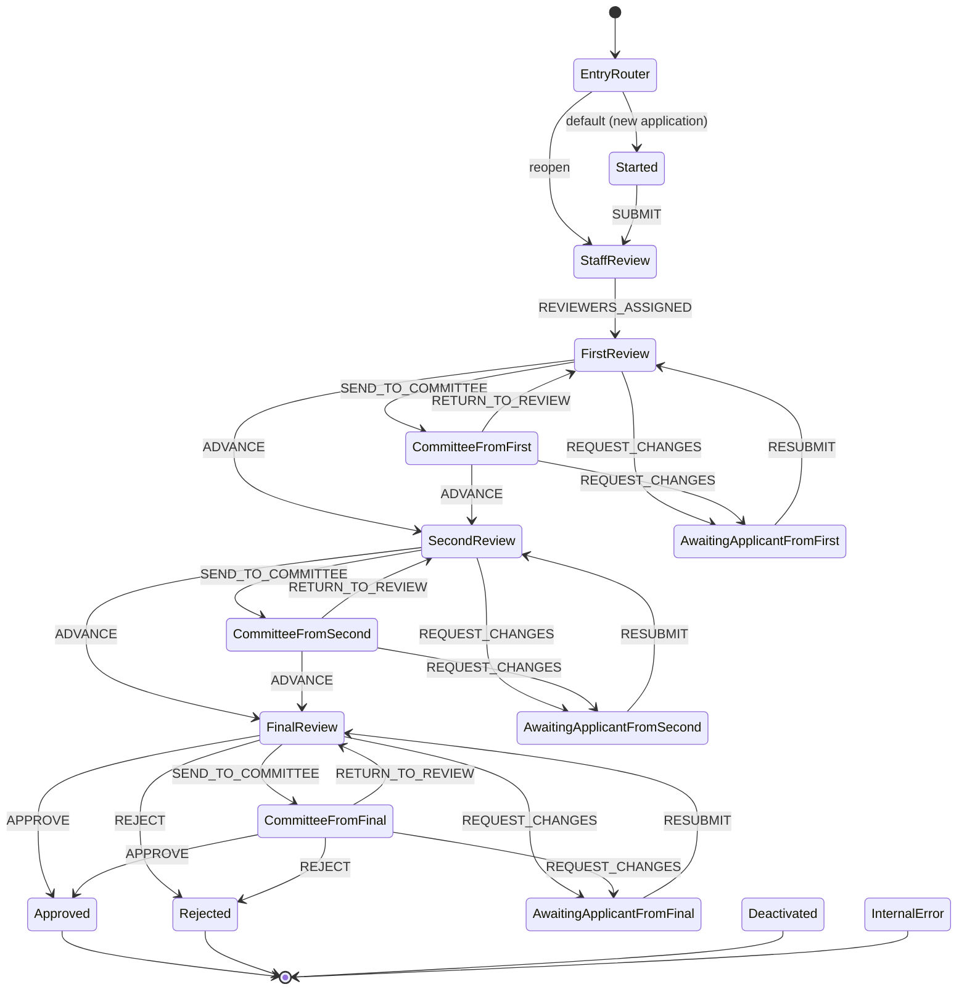
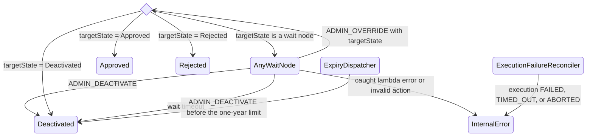

# Practitioner application workflow

A Standard Step Functions execution is the normal writer of an application's `status`. `EnterState` writes that status in the same DynamoDB transaction that stores the task token. The UI reads the projection. Staff queues use `statusGSI` and `actorGSI`, which are eventually consistent and are not used to authorize an action.

`ExecutionFailureReconciler` is the exception. After an execution is `FAILED`, `TIMED_OUT`, or `ABORTED`, no state node can run, so the reconciler projects `internal-error` when the execution ARN and generation are still current.

## State diagram

Admin override and expiry, drawn once. Every wait node has these edges.

## Node, status, and actor

- `Started` projects `started`. The applicant acts.
- `StaffReview` projects `staff-review`. A compact admin assigns reviewers.
- `FirstReview`, `SecondReview`, and `FinalReview` project `first-review`, `second-review`, and `final-review`. The matching assigned reviewer acts.
- `CommitteeFromFirst`, `CommitteeFromSecond`, and `CommitteeFromFinal` project `committee-review`. The reviewer who sent the application there keeps the actor role and can still edit that role's section reviews.
- `AwaitingApplicantFromFirst`, `AwaitingApplicantFromSecond`, and `AwaitingApplicantFromFinal` project `awaiting-applicant`. The applicant acts. Resubmit returns to that tier's review node, not back to committee.
- `Approved`, `Rejected`, `Deactivated`, and `InternalError` are terminal. `EnterState` writes `completed` and stores no task token. `InternalError` projects `internal-error`. Reopen accepts it along with the other terminal statuses.

`ADVANCE`, `APPROVE`, and `REJECT` require every current section review for the acting role to be approved or rejected. `REQUEST_CHANGES` and `RETURN_TO_REVIEW` do not. A compact admin may override to any allowed target or deactivate. A jurisdiction admin scope grants neither.

## Lifecycle

Create stores `workflowExpiresAt` one year out and a one-time EventBridge schedule named `{applicationId}-g{generation}` before the execution starts. The schedule calls the expiry function, which sends `ADMIN_DEACTIVATE` through the current task token when the generation, execution, and schedule name still match and the status is not terminal. The schedule uses `ActionAfterCompletion=DELETE`.

The state machine timeout remains one year. Callback waits are 364 days and 23 hours so the schedule can reach `Deactivated` before that timeout. A wait timeout writes `deactivated` and the execution succeeds. A caught lambda error or invalid action writes `internal-error` and then fails the execution, so the failed-execution alarm fires. An execution that stops before that node is handled by `ExecutionFailureReconciler`, which also writes `internal-error`. Admin deactivation and the one-year expiry write `deactivated` and do not alarm.

Reopen is compact-admin only. It stops the current execution when that execution is still running, then starts a new generation at `StaffReview`. Reviewer assignment and section reviews stay on the items. The new generation accepts a normal `REVIEWERS_ASSIGNED` edge.

A sandbox deploy may set context `application_workflow_lifetime_seconds` while `sandbox` is true. That sets `APPLICATION_WORKFLOW_LIFETIME_SECONDS` on the application Lambdas. The runtime ignores the variable when `ENVIRONMENT_NAME` is `test`, `beta`, or `prod`.

## DynamoDB items

One partition per application: `pk = {compact}#APPLICATION#{applicationId}`.

- `sk = APPLICATION` is the application: status, `stateName`, version, generation, execution ARN, reviewer subs, embedded application reviews, and the lifecycle fields.
- `sk = SECTION#{section}` is one of `personalInformation`, `licenseHistory`, `education`, `conductHistory`, `homeState`, or `acknowledgements`, including that section's reviews.
- A transition item records each state entry.
- A request item records one `requestId` so a retry returns the original outcome.

Indexes, all eventually consistent:

- `statusGSI` on `statusGSIPK = {compact}#STATUS#{status}`
- `actorGSI` on `actorGSIPK = {compact}#ACTOR#{actorSub}`
- `applicantGSI` on `applicantGSIPK = {compact}#PROVIDER#{providerId}`

API responses do not include `taskToken`, `executionArn`, `pendingAction`, or `reopenLock`.

## API routes

Under `/v1/compacts/{compact}/applications`. The practitioner routes use the provider-user authorizer. The staff routes use the staff-user authorizer and the `{compact}/admin` scope only.

Practitioner:

- `POST /applications` creates an application.
- `GET /applications/{applicationId}` reads the caller's application.
- `PATCH /applications/{applicationId}/sections/{section}` updates one section.
- `POST /applications/{applicationId}/submit` sends `SUBMIT`.
- `POST /applications/{applicationId}/resubmit` sends `RESUBMIT`.

Staff:

- `GET /applications` lists summaries. `status` queries `statusGSI`. `mine=true` queries `actorGSI` for the caller. `pageSize` and `lastKey` paginate.
- `PUT /applications/{applicationId}/reviewers` assigns compact-admin reviewers. When the application is in `StaffReview` and all three reviewers are set, the handler signals `REVIEWERS_ASSIGNED` once.
- `PUT /applications/{applicationId}/sections/{section}/review` saves the section review for the role implied by the current `stateName`.
- `POST /applications/{applicationId}/transition` takes one workflow action, including `ADMIN_DEACTIVATE`.
- `POST /applications/{applicationId}/admin/status` overrides `stateName`.
- `POST /applications/{applicationId}/reopen` starts a new staff-review generation.

`GET /applications/{applicationId}` stays on the practitioner authorizer. A method can have one authorizer, so staff full reads are not a second method on that path. A settled transition returns the application. A transition that has not settled returns HTTP 202 with `pending` and `expectedStatus`. A version or state conflict returns HTTP 409.
